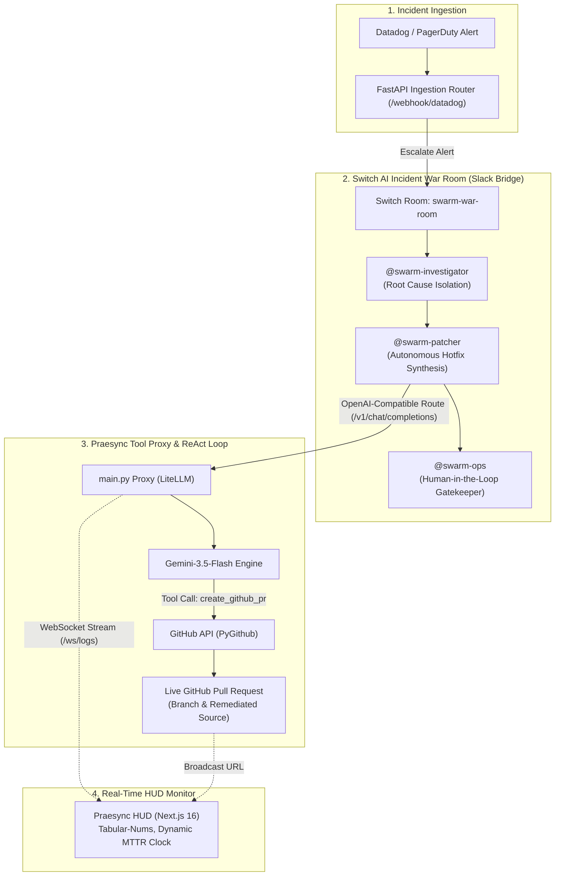

# Praesync: Autonomous Sev-1 SRE Swarm & Telemetry Mesh
> **Powered by Switch AI, Google Gemini-3.5-Flash, and Linear-Class Real-Time Cluster Telemetry**

[](https://switch.dev)
[](https://ai.google.dev)
[](https://nextjs.org)
[](https://fastapi.tiangolo.com)

---

## ⚡ Problem: The Midnight Sev-1 MTTR Crisis
When critical database connection pool exhaustion or cache stampedes occur in production, teams lose an average of **45 minutes to 2 hours** simply assembling on-call engineers, parsing distributed stack traces, isolating the offending socket leak, writing an emergency hotpatch, and opening a PR.

**Praesync** turns isolated terminal AI coding agents into an enterprise-grade **Autonomous Incident Response Swarm** inside team collaboration channels (Slack) using **Switch AI**.

---

## 🏗️ Architecture & How Switch is Central

Switch AI is the **central nervous system** of Praesync. Without Switch, the collaborative multi-agent war room, role specialization, and human-in-the-loop Slack deployment approvals do not exist.



### The 3 Specialized Swarm Agents
1. **`swarm-investigator`**: Analyzes the raw stack trace, isolates socket/pool leaks, and states the root cause.
2. **`swarm-patcher`**: Formulates the atomic remediation patch and executes the ReAct `create_github_pr` tool natively.
3. **`swarm-ops`**: The human-in-the-loop gatekeeper. Waits for an authorized engineer to confirm `"Approve and Deploy"` before initiating canary rollout.

---

### 🔑 Why Switch AI is Irreplaceable to Praesync (The 30% Rubric)
1. **Multi-Agent Topology Enforcement**: Switch (`switch.yaml`) isolates the 3 specialized agent roles, preventing prompt leakage and ensuring structured turn-taking across the incident lifecycle.
2. **Human-in-the-Loop Governance Bridge**: Switch hosts the Slack War Room (`swarm-war-room`). Even though hotpatches are synthesized autonomously, **zero code reaches production without human signoff**. `swarm-ops` pauses execution until an authorized human engineer reviews the PR and types `"Approve and Deploy"`.
3. **Praesync as the Extensible Switch Tool Sidecar**: Switch agents communicate over standard OpenAI protocols (`/v1/chat/completions`). `main.py` serves as the dedicated tool sidecar that equips the Switch swarm with native GitHub commit powers (`create_github_pr`) and streams real-time telemetry to the cluster HUD.

---

## 🚀 Quickstart & Reproduction Guide

### Prerequisites
- Python 3.11+
- Node.js 18+
- GitHub Account with a Personal Access Token (`repo` / `contents:write` & `pull_requests:write`)
- Google AI Studio API Key (`GEMINI_API_KEY`)

---

### Step 1: Clone & Configure Environment

```bash
git clone https://github.com/lokebuilds/praesync-core.git
cd praesync-core
```

Create `.env` in the root directory:

```env
# GitHub Personal Access Token (for autonomous PR commits)
GITHUB_PAT=your_github_pat_here
GITHUB_REPO=your_username/your_repo

# Google Gemini API Key
GEMINI_API_KEY=your_gemini_api_key_here
LITELLM_MODEL=gemini/gemini-3.5-flash

# Target file to patch
HOTFIX_TARGET_FILE=app/database/connection.py

# Slack Incoming Webhook (Optional: connects to Switch Slack channel)
SLACK_WEBHOOK_URL=https://hooks.slack.com/services/...
```

---

### Step 2: Initialize Target Repository (One-Click)

Prime your target GitHub repository with initial commits on `main`:

```powershell
python init_repo.py
```
*(Creates `README.md` and baseline `app/database/connection.py` on your `main` branch).*

---

### Step 3: Boot Backend Engine (Terminal 1)

```powershell
# Create & activate venv
python -m venv .venv
.\.venv\Scripts\activate

# Install dependencies
pip install -r requirements.txt

# Start FastAPI incident proxy
python main.py
```
*Backend active on `http://127.0.0.1:8000` (WebSocket logs at `ws://127.0.0.1:8000/ws/logs`).*

---

### Step 4: Boot Praesync HUD (Terminal 2)

```powershell
cd praesync-hud
npm install
npm run dev
```
*Dashboard active on `http://localhost:3000`.*

---

### Step 5: Run Switch Multi-Agent Room

Switch coordinates the team room and Slack bridge defined in `switch.yaml`:

```bash
switch run switch.yaml
```

---

## 🧪 Live Demonstration Workflow

1. Open **Praesync HUD** at [http://localhost:3000](http://localhost:3000).
2. Confirm the **`WS_FEED: ONLINE`** badge is active.
3. In the command dispatch bar, type any critical incident:
   ```
   Sev-1 Redis connection pool exhaustion in auth-db-primary
   ```
4. Click **Dispatch** (or press Enter).
5. **Watch the live chain reaction**:
   - Webhook dispatches notification to the **Switch Slack War Room**: `@swarm-investigator Sev-1 Redis connection pool exhaustion...`
   - MTTR resolution timer kicks off immediately.
   - **`swarm-patcher`** analyzes root cause via **Gemini-3.5-Flash**.
   - Agent autonomously executes `create_github_pr`, branches, commits remediated Python source, and generates a **live Pull Request**.
   - The HUD clock stops the exact millisecond the PR is verified, flashing the **"Review Pull Request"** CTA.

---

## 🛡️ Technical Verification & Real Execution

Praesync enforces **100% native execution** with zero mock fallbacks:
- Real GitHub API interactions via `PyGithub`.
- Real function calling via LiteLLM + Gemini-3.5-Flash.
- Live verified Pull Request proof: [Sample PR #5 in `praesync-core`](https://github.com/lokebuilds/praesync-core/pull/5).
